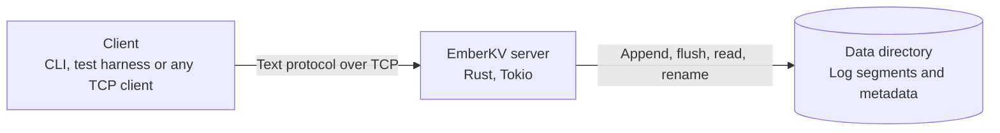
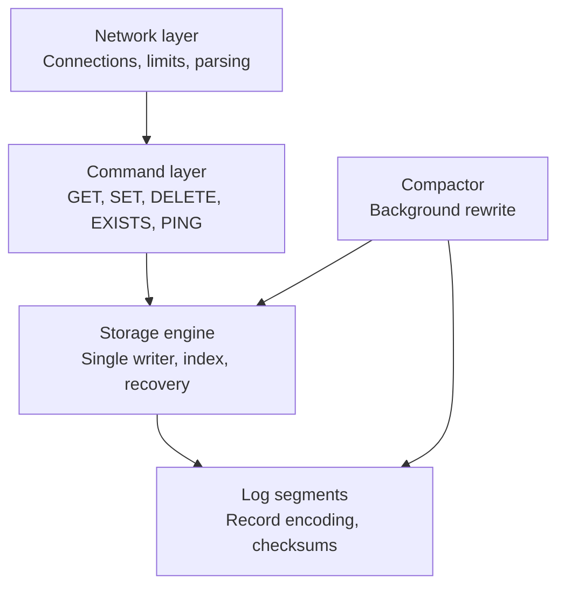
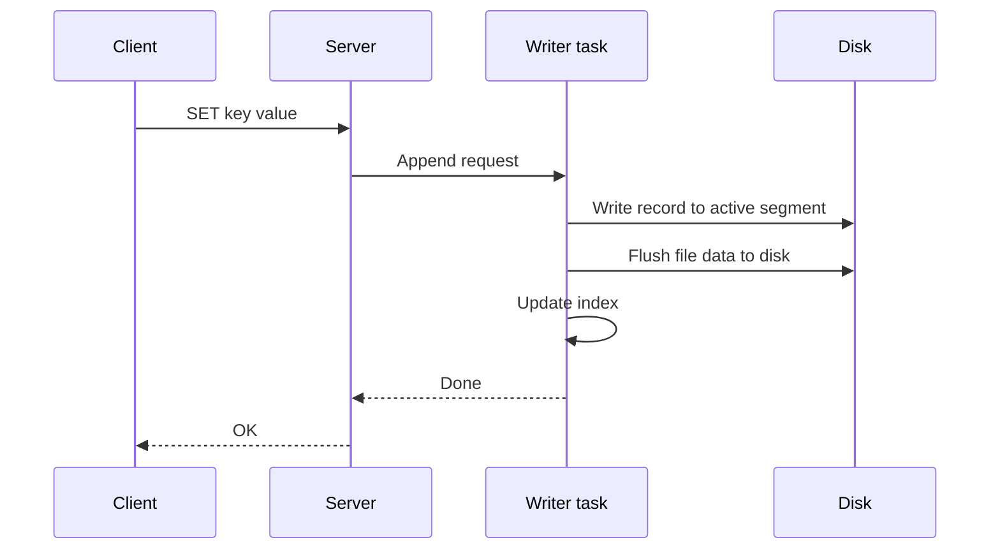

# Architecture

Planned design, not yet implemented. This follows the arc42 structure used across the workspace, kept
short until code exists. Diagrams are Mermaid.

## 1. Goals

| Priority | Quality goal | Meaning here |
|---|---|---|
| 1 | Durability | An acknowledged write survives a process crash |
| 2 | Integrity | Corrupted data is detected, never returned |
| 3 | Understandability | Each mechanism can be explained from the code in a few minutes |
| 4 | Performance | Measured and reported honestly, never at the expense of 1 and 2 |

## 2. Constraints

- One process, one data directory, one machine.
- Rust stable with no `unsafe` in project code. Few dependencies, each with a reason in an ADR.
- Durability depends on the operating system and disk honouring flush requests. Tests cover process
  crashes, not power loss.

## 3. Context

## 4. Solution strategy

The design is a **log-structured hash table**, the approach used by Bitcask, chosen because it is the
simplest design in which every durability mechanism still appears.

| Problem | Approach | Decision |
|---|---|---|
| Fast, safe writes | Append each change to the end of a log file and flush before acknowledging | ADR 0001 (planned) |
| Fast reads | An in-memory index from each key to the position of its newest record on disk | ADR 0001 (planned) |
| Detecting damage | A checksum on every record | ADR 0002 (planned) |
| Disk growing forever | Compaction rewrites only live records into a new segment | ADR 0003 (planned) |
| Wire protocol | A small text protocol, possibly a subset of Redis's so standard tools work | ADR 0004 (planned) |

**Rejected for the first release:** a B-tree (much more code before anything is durable) and an LSM
tree (sorted runs and merging add complexity that this project does not need yet). Both are worth
naming in an interview, with the reason they were not chosen.

## 5. Building blocks

Planned Cargo workspace:

| Crate | Responsibility |
|---|---|
| `emberkv-storage` | Record format, segments, index, recovery, compaction. No networking |
| `emberkv-server` | Tokio TCP server, protocol parsing, limits, metrics |
| `emberkv-cli` | A small client used by humans and by the crash-test harness |

The storage crate can be tested without a network, which is what makes the crash and property tests
practical.

## 6. Data on disk

**Record format** (all integers little-endian):

| Field | Size | Purpose |
|---|---|---|
| Header checksum | 4 bytes | CRC-32C of the two length fields, so a damaged length is caught before it is trusted |
| Key length | 4 bytes | Bounded by the configured key limit |
| Value length | 4 bytes | A reserved value marks a deletion (tombstone) |
| Body checksum | 4 bytes | CRC-32C of key and value (see [research](research.md#3-checksums-crc-32c-not-crc-32)) |
| Key | variable | Raw bytes |
| Value | variable | Raw bytes, absent for a deletion |

**Why two checksums:** a reader must use the length fields to know how many bytes to read. If one
checksum covered the whole record, a single flipped bit in a length could make the reader run past
the end of the file and report a harmless torn tail, and recovery would then cut off every good record
after it. This was found by experiment in the feasibility prototype. Checking the header first means a
damaged length is reported as corruption, never mistaken for a crash.

**Recovery rule:** a torn tail is only accepted at the end of the newest segment, and only if no valid
record can be found anywhere after it. A crash can only interrupt the last write, so a valid record
beyond a supposed tear proves the damage came from somewhere else. Anything else that looks torn is
treated as corruption. This also covers the rare case where a damaged length still matches its checksum.

**Segments:** the log is split into numbered files. Exactly one, the newest, is open for appends. When
it reaches a size limit it is flushed, closed and becomes read-only, and a new one starts.

**Index:** an in-memory ordered map from key to segment number, offset and length. Being ordered keeps
range scans possible later. Every key lives in memory, so the number of keys is limited by RAM; this is
a documented trade-off of the design.

## 7. Runtime view

### 7.1 Write

One writer task owns the active segment, so appends never interleave. Readers use the index and read
closed or active segments at known offsets without blocking the writer for long.

### 7.2 Recovery at startup

1. List segments in order.
2. Read each record, check its checksum and rebuild the index.
3. In the newest segment, a damaged or incomplete final record is the expected result of a crash during
   a write: truncate it, log what was discarded, and continue.
4. Damage anywhere else is not explained by a crash. Stop with a clear error rather than guess.

### 7.3 Compaction

1. Pick closed segments to compact. The active segment is never compacted.
2. Copy only records that the index still points to into a new segment, then flush it.
3. Rename it into place and flush the directory, so the new name itself survives a crash.
4. Update the index to point at the new segment.
5. Delete the old segments only after all of the above.

A crash at any step leaves either the old segments, or both old and new. Recovery handles both, because
the newest copy of each key wins by segment order.

## 8. Cross-cutting concepts

- **Flushing:** a write reaching the operating system is not on disk until it is flushed. New and
  renamed files also need their directory flushed, or the file name can be lost in a crash.
- **Limits:** maximum key size, value size, request size, connections and segment size, all validated at
  startup.
- **Errors:** protocol errors close nothing but the offending request; storage errors that threaten
  integrity stop writes rather than continuing in an unknown state.
- **Observability:** structured logs and counters for writes, reads, flush time, recovery results,
  discarded bytes, compaction runs and disk use.

## 9. Risks

| Risk | Response |
|---|---|
| Flushing every write is slow | Measure first. Group commit is later scope, and must keep the crash tests passing |
| Windows and Linux flush and rename semantics differ | Develop and test on Linux; document the tested platform |
| Keys exceed RAM | Documented limit of the design; hint files and an on-disk index are later scope |

## 10. Glossary

| Term | Meaning |
|---|---|
| Write-ahead log | A file where every change is recorded before it is considered done |
| Flush (`fsync`) | Asking the operating system to put written data on the physical disk |
| Torn write | A record only partly written because the process stopped mid-write |
| Tombstone | A record that marks a key as deleted |
| Compaction | Rewriting live records to reclaim space used by old versions and deletions |
